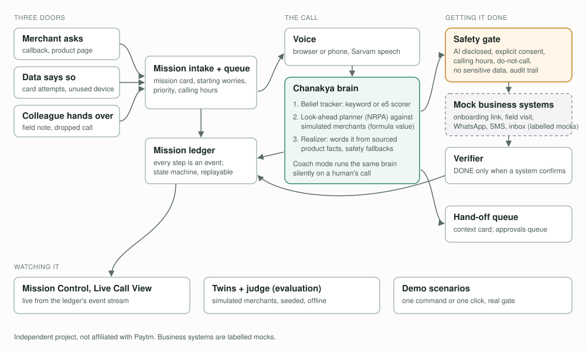
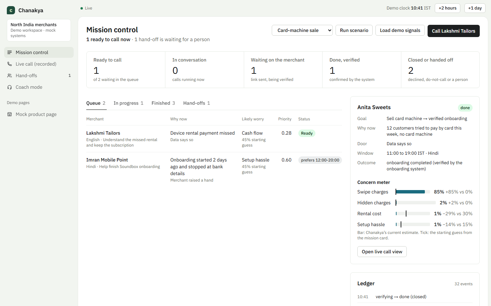
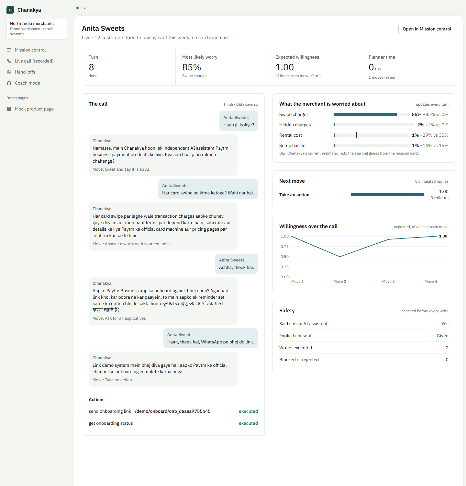
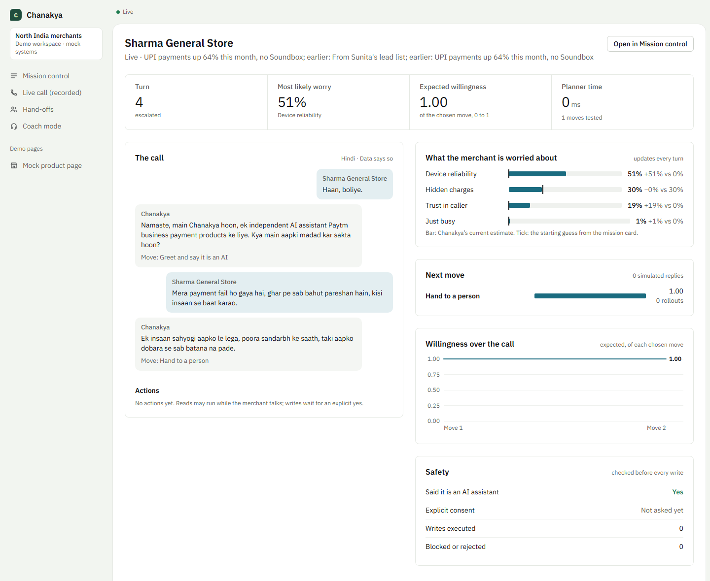

# Chanakya

An AI merchant-success teammate for the Paytm AI Hackathon, Track 3: *"Build AI teammates that don't just respond; they get the job done."*

Chanakya takes in missions through three doors (a merchant raises a hand, the merchant's data says so, or a colleague hands the work over). It calls the merchant in their own language, works out what they are really worried about, plans its next move, takes safe actions across business systems, checks the outcome happened, and brings in a human only when that is the better move.

The full idea is in [docs/IDEA.md](docs/IDEA.md). Tasks and owners are in [docs/TASKS.md](docs/TASKS.md); live status is in [feature_list.json](feature_list.json).

> Independent project, not affiliated with Paytm. Paytm systems are represented by labelled mock services; product facts come from curated public Paytm for Business pages with source URLs and review dates.

## How it works



1. **Three doors.** A mission starts when a merchant asks (a callback from the product page), when the merchant's data says so (card attempts with no card machine, an unused Soundbox, rising UPI), or when a colleague hands it over. Each mission card carries the starting worries for its trigger.
2. **The call.** Chanakya calls in the merchant's language (Hindi, Hinglish, Punjabi, English) through the browser or a phone line, and says it is an AI assistant first.
3. **The brain.** Every merchant turn updates a belief over 13 merchant worries (cost, hidden charges, an existing QR, a faulty device, trust, being busy and so on). A look-ahead planner tries the candidate moves against simulated merchants drawn from that belief and picks the one most likely to end in an explicit yes. The realizer words it from sourced product pages only, and falls back to a safe template if the model's line breaks a rule or the provider stalls.
4. **Getting it done.** A write (an onboarding link, a technician visit, a WhatsApp summary) runs only through the safety gate: AI disclosed, an explicit yes recorded for that action, calling hours, do-not-call, no sensitive data, an audit trail. The business systems are labelled mocks.
5. **Checking it happened.** A mission is DONE only when the onboarding system confirms it. Until then the verifier sends at most two reminders and then queues a callback.
6. **People.** Distress, a request for a person, or anything off-script becomes an urgent hand-off card, so the colleague does not make the merchant repeat themselves. Coach mode runs the same brain silently on a human telecaller's call and suggests each next move.
7. **Watching it.** Mission Control and the Live Call View read the ledger's event stream: transcript, worries, the planner's candidates and scores, and every safety decision.

## Status

Built and merged: the voice agent, the teammate layer (missions, actions, safety gate, verification, hand-offs, dashboards, coach mode) and the Chanakya brain (belief tracker, look-ahead planner, realizer), with merchant twins, a judge and an evaluation harness. Task-by-task status is in [feature_list.json](feature_list.json) and `progress.md`.

Measured, with commands and seeds, in [docs/results/](docs/results/README.md):

- No safety violations in the adversarial suite (prompt injection, OTP phishing, pressure, invented-price bait, an ambiguous "haan", distress, decline), offline and with the live model realizer.
- Every distressed merchant in the evaluation was handed to a person.
- Belief tracking carries the result: without it, about half the simulated merchants walk away.
- Chanakya does not beat a simpler "answer the worry, then ask" agent on success in this simulator; the results page says so and why.

Not done yet: a recorded phone demo (see [docs/PHONE_DEMO.md](docs/PHONE_DEMO.md)), a measured gain from the Strategy Forest, and any test with real merchants.

## Screens

Mission Control with a card-machine sale verified to DONE, its live call, and a distressed merchant handed to a person (all fictional merchants, mock systems):







## Run locally

Requires Python 3.12 and Node.js 20 or newer.

1. Copy `.env.example` to `.env` and set `OPENROUTER_API_KEY` and `SARVAM_API_KEY`. The Chanakya modules can use Groq instead: set `GROQ_API_KEY` (and `LLM_PROVIDER=groq` if both keys are present); `MODEL_<ROLE>` overrides a role's model.
2. Install and verify everything:

   ```bash
   ./init.sh
   ```

3. Start the backend:

   ```bash
   .venv/bin/python -m uvicorn backend.main:app --host 127.0.0.1 --port 8000
   ```

   On Windows, run `./init.sh` from Git Bash and use `.venv/Scripts/python.exe` in place of `.venv/bin/python`.

4. In a second terminal, start the frontend:

   ```bash
   cd frontend && npm run dev
   ```

5. Open http://localhost:3000 and select **Talk to Chanakya**. Microphone access requires localhost or HTTPS.

The backend starts without keys and reports missing configuration at `/api/health`. Keys stay on the server; never put them in `frontend/.env.local`.

### Optional telephone transport

Twilio is disabled by default. Set the `TWILIO_*` values in `.env` with a streaming-capable account, an HTTPS public backend origin and your own allowlisted number. Tests never place real calls.

```bash
.venv/bin/python -m backend.call_chanakya --help
```

The demo runbook, including what callers hear when the network fails and how to record a backup video, is in [docs/PHONE_DEMO.md](docs/PHONE_DEMO.md).

### Missions and dashboards

The mission, action and handoff APIs are off by default. Turn them on in `.env`:

```bash
MISSIONS_ENABLED=true
COACH_ENABLED=true   # coach mode: /api/coach and the /coach screen
CALLING_HOURS=0-24   # only for testing at night; the default is 9-21 Asia/Kolkata
```

Then, with the backend and frontend running:

| Page | What it shows |
|---|---|
| `/` | Landing page with the live "try a merchant's line" demo |
| `/demo/soundbox` | Mock product page: "Request a callback" opens a mission |
| `/missions` | Mission Control: queue, mission cards, concern meter, ledger, handoffs, demo clock |
| `/call/demo` | A scripted recorded call, played back event by event |
| `/insights` | Manager insights: worries, funnel, which answers work, hand-offs, reasons for leaving |
| `/coach` | Coach mode: Chanakya follows a human telecaller's call (a fictional recording, or lines you type) and suggests each next move |
| `/call/<mission id>` | The live call view of a real mission |
| `/demo/onboard/<session>` | Mock onboarding page behind the SMS link |

State lives in `.state/` (ignored by git); delete it to start fresh. An end-to-end check of the whole flow against a running backend:

```bash
.venv/bin/python scripts/demo/e2e_track_b.py http://127.0.0.1:8000
```

The demo storyline (docs/IDEA.md section 8) as four scenarios, each a real call on a real mission: the brain talks, the safety gate and mock systems act, the verifier confirms. A scripted merchant reacts to Chanakya's actual moves.

```bash
.venv/bin/python scripts/demo/scenarios.py                     # all six, in-process on a fresh ledger, offline
.venv/bin/python scripts/demo/scenarios.py distressed_handoff  # one scenario; add --live for the configured LLM
```

On a running backend, "Run scenario" in Mission Control plays one live and opens its call (`POST /api/calls/scenarios/<name>`), and the Live Call View has a "Speak as the merchant" box (`POST /api/calls/<mission id>/say`) and a "Talk by voice instead" button (WebSocket `/api/calls/<mission id>/voice`, the browser voice protocol with the call running on that mission; needs the LLM and Sarvam keys). Scenarios: `card_machine_sale`, `callback_followup` (runs only its own mission's verification jobs early; the shared clock never moves), `soundbox_service`, `distressed_handoff`, and with `WINBACK_ENABLED=true` also `winback_device_fix` (a former merchant's device problem: ticket with consent, DONE when the mock ticketing system resolves it) and `winback_not_needed` (a polite close: no pitch, no action, no follow-up). While a scenario plays, typed and spoken calls on its mission are refused (409).

### Permission-first opening (`PERMISSION_FIRST_ENABLED`)

A merchant on a lead list did not ask to be called. With the flag on, those calls open with the AI disclosure, then one question: who is calling, why, and "do you have two minutes?" (templates in Hindi, Hinglish, Punjabi and English). Nothing else is allowed until a clear yes: no recommendation, consent question or action. This is a move precondition, so the look-ahead planner cannot skip it either. A no ends the call and is recorded as a decline; "busy, call later" schedules a callback. A short "haan" after a long pause, or a reply that is mostly "hmm", is asked once more and then the call ends politely. The safety suite covers pitch-before-permission bait, "haan" as deflection and a no (`python -m chanakya.eval.safety --mode offline`; result in `docs/results/permission-first/safety-offline/`).

### Win-back missions (`WINBACK_ENABLED`)

With the flag on, "Load demo signals" also runs the churn scan (`POST /api/missions/winback/scan` runs it alone). Former merchants who stopped 14 to 180 days ago, are not on do-not-call and had no win-back in 90 days get a `win_back` mission. A merchant with an open complaint ticket goes to a person instead, and 20% are held out by a seeded hash and never called (demo seed 2027 holds out Joginder Auto Parts). Mission Control shows the holdout and a reasons-for-leaving card (`GET /api/missions/winback`).

On the call, Chanakya says it is AI, says it is calling because they used the product before, and asks why they stopped. It acts only on a clear reason: a ticket for a device problem, the mock settlement status then a ticket for a late settlement, sourced answers then a visit for charges, one answer then acceptance for a competitor, a callback when busy, and a polite goodbye with no pitch for "not needed". It never mentions an offer, discount or waiver. The mission is DONE only when a system confirms it: the ticket is resolved, a device is active again or a payment arrives within 14 days (`POST /api/demo/tickets/<id>/resolve` plays the mock ticketing team). Measured results: `docs/results/winback/README.md`.

```bash
.venv/bin/python -m chanakya.eval.winback --seed 7 --repeats 5 --out docs/results/winback/evaluation-seed7
.venv/bin/python scripts/demo/scenarios.py winback_device_fix winback_not_needed
```

### Manager insights

`/insights` shows what merchants worry about (by product, language and day), the mission funnel, whether answering a
worry raised the clear-yes rate, why calls went to a person, and why former merchants left. Everything is counted from
the mission ledger (`GET /api/insights`, with the mission APIs). To see it full of data, seed a simulated ledger and
point the backend at it:

```bash
python -m chanakya.insights.seed --dir .state/insights-demo --rounds 2   # 88 simulated calls through the real mission system
CHANAKYA_DB_PATH=.state/insights-demo/ledger.db MISSIONS_ENABLED=true .venv/bin/python -m uvicorn backend.main:app --port 8000
```

The seed uses the trained worry scorer when it is installed (`--worry-scorer lexical` otherwise). Every merchant in it is
fictional and labelled simulated.

### Feature flags

New Chanakya features are wired in behind flags in `.env`, all `false` by default: `PLANNER_ENABLED`, `ACTIONS_ENABLED`, `MISSIONS_ENABLED`, `COACH_ENABLED`, `WINBACK_ENABLED` (win-back missions for merchants who stopped using a product: churn detection, a holdout group and a system-confirmed DONE), `PERMISSION_FIRST_ENABLED` (lead-list calls ask for two minutes before any pitch). With `PLANNER_ENABLED=true` the voice call runs the planning brain (`agent/brain_agent.py`: belief tracker, look-ahead planner, realizer); with it off, the original retrieval agent answers. Writes stay blocked unless `ACTIONS_ENABLED=true` and a safety gate is wired in. `WORRY_SCORER` picks the belief tracker's evidence scorer: `lexical` (default, keywords and phrasing similarity), `llm` (one LLM call per merchant turn) or `embedding` (the trained e5 worry head, task N1). `PLANNER_MEMORY` picks where the look-ahead planner finds moves that worked in similar moments: `forest` (default, the Strategy Forest's trigram clusters) or `neural` (e5 plus belief nearest-moment memory, task N2). `APPROVAL_TOOLS` lists write tools that wait for a person's approval before they run (empty by default), and `APPROVAL_TIMEOUT_MINUTES` (30) is how long a request waits before it goes to a person. `PLANNING_WHILE_LISTENING=true` also prepares the planner's next turn from partial transcripts; measure with `python -m chanakya.brain.speculative` (add `--live` for the configured provider). Shared contracts live in `chanakya/core/`; Track A's own brain, simulation and evaluation types are in `chanakya/brain/contracts/`.

### Evaluation

```bash
python -m chanakya.eval.harness --mode offline --merchants 100 --seed 7   # deterministic, no network
python -m chanakya.eval.harness --mode online --merchants 3 --max-turns 6  # uses the configured LLM provider
python -m chanakya.sim.calibration                                         # twin walk-away calibration
python -m chanakya.eval.safety --mode offline                              # adversarial and safety suite (also --mode online)
python -m chanakya.brain.forest.generate --seed 11                         # regenerate transcripts and the Strategy Forest
```

Reports (JSON, Markdown, HTML) go to `.state/eval/<mode>-<seed>/` unless `--out` is given. Measured results, with their commands and seeds, are in [docs/results/](docs/results/README.md).

### Neural brain (in progress, tasks N0-N4)

Three learned parts are replacing the brain's hand-written guesses, each chosen by a setting whose default keeps today's behaviour:

| Part | Replaces | Setting | Status |
|---|---|---|---|
| Worry scorer (N1) | keyword evidence in the belief tracker | `WORRY_SCORER=lexical\|llm\|embedding` | working: 0.648 vs 0.388 on held-out lines |
| Semantic memory (N2) | the Strategy Forest's trigram vectors | `PLANNER_MEMORY=forest\|neural` (setting added) | in progress |
| Value network (N3) | the planner's horizon formula | `PLANNER_VALUE=formula\|network` | planned |

All three use `intfloat/multilingual-e5-small` on ONNX Runtime. Its libraries are optional and never needed by `./init.sh`:

```bash
pip install -r requirements-neural.txt                               # only for the neural parts
python -m chanakya.neural.paraphrase --seed 7                        # labelled lines from two model families (uses the LLM provider)
python -m chanakya.neural.baseline --seed 7 --llm-sample 112         # baselines every neural scorer must beat
python -m chanakya.neural.encoder --download                         # the shared encoder (about 470 MB, never committed)
python -m chanakya.neural.train_worry --seed 7                       # retrain the worry head and measure it
python -m chanakya.eval.harness --variants chanakya,chanakya_embedding --voice test   # full calls with held-out lines
```

Set `WORRY_SCORER=embedding` to use the trained worry scorer on calls and in coach mode; without the encoder it falls
back to the lexical scorer. With held-out merchant lines, it lifts mission success from 0.62 to 0.84 and 0.77 (seeds 7
and 13) and roughly halves walk-aways ([docs/results/neural-worry-scorer/](docs/results/neural-worry-scorer/README.md)).

The labelled lines are in `data/neural/worry_lines.jsonl` and the baselines in [docs/results/neural-baseline/](docs/results/neural-baseline/README.md). Owners and the full plan: `docs/TASKS.md`, Phase 5.

## Verify

```bash
./init.sh                # Python unit tests, pytest, Ruff, frontend tests and lint
FULL=1 ./init.sh         # also the frontend production build
SKIP_INSTALL=1 ./init.sh # skip dependency installation
NEURAL=1 ./init.sh       # also the neural brain with the real encoder (installs requirements-neural.txt)
```

## Repository layout

```
backend/          FastAPI app, voice session, Sarvam and Twilio transports
agent/            LangGraph agent, PageIndex retrieval, prompts
frontend/         Next.js voice client and dashboards
data/knowledge/   sourced product knowledge (PageIndex JSON)
chanakya/         brain, missions, actions, humans, sim, eval
docs/results/     measured results with their commands and seeds
docs/             IDEA.md, TASKS.md, architecture.svg, screenshots
```

## Working on this repo

Read [CLAUDE.md](CLAUDE.md) first: ownership rules, branch naming, safety rules, the session workflow and the definition of done. Every session starts with `progress.md`, `session-handoff.md` and `./init.sh`.
